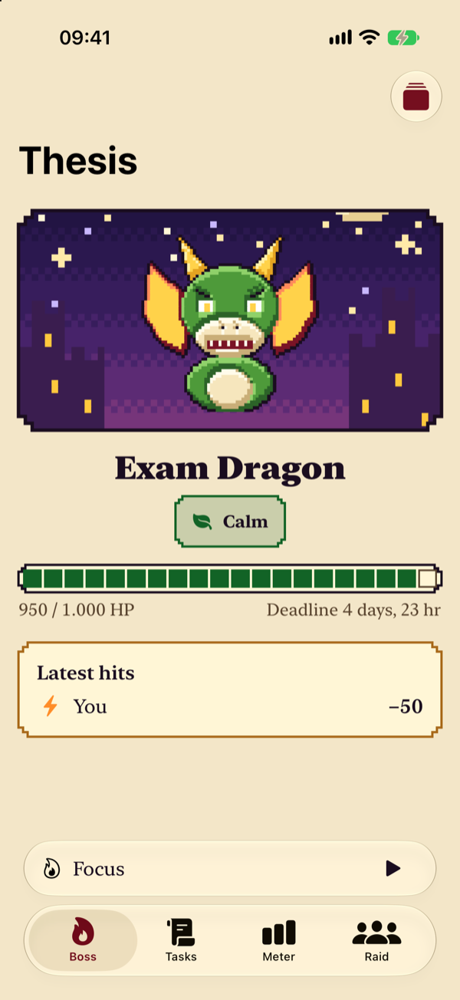
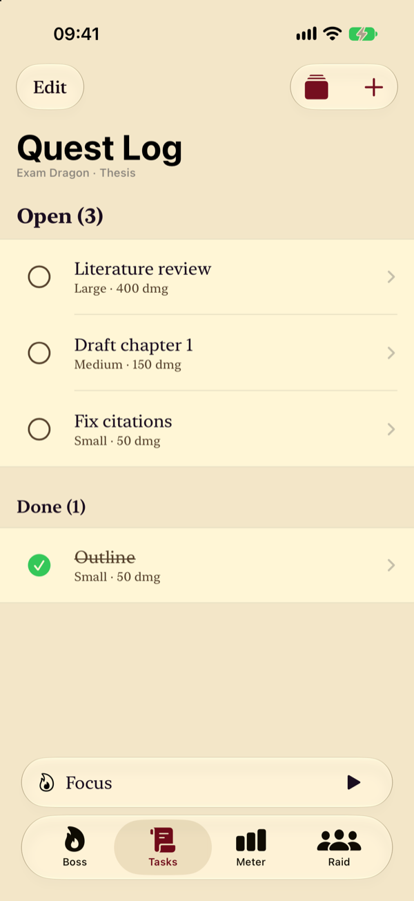
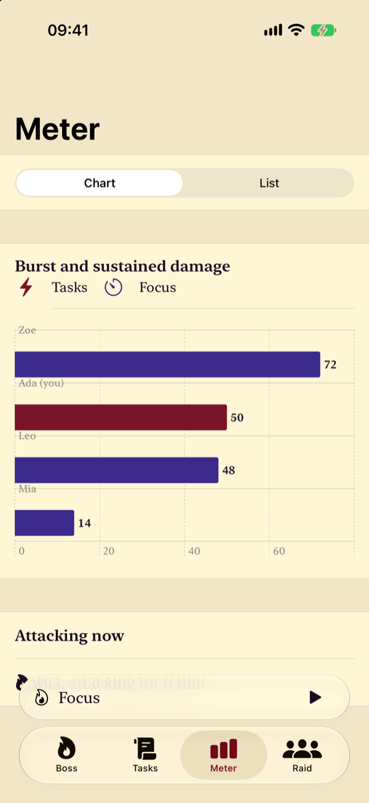
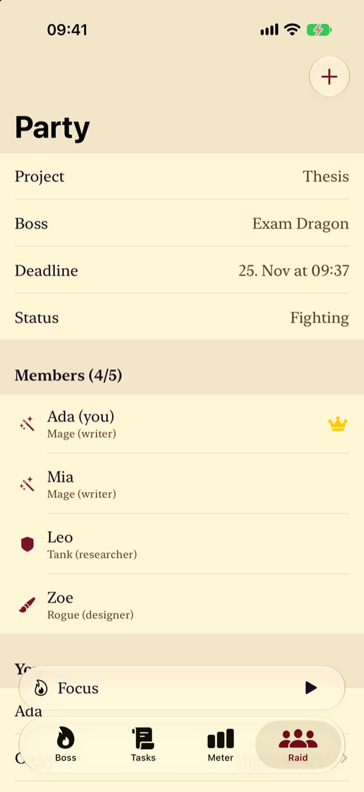
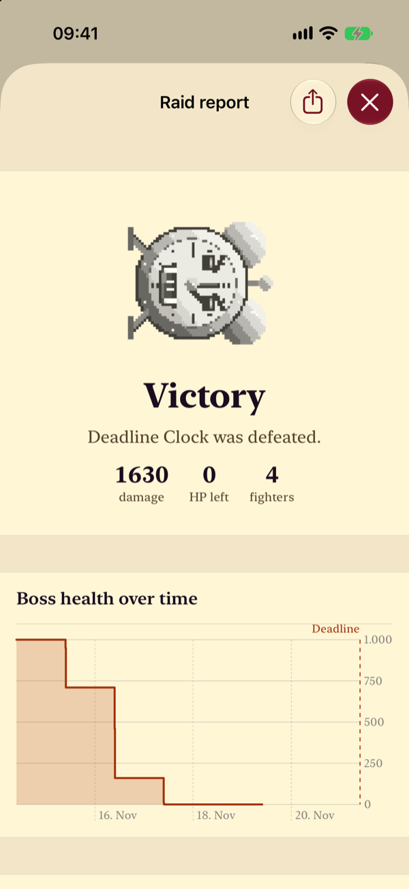
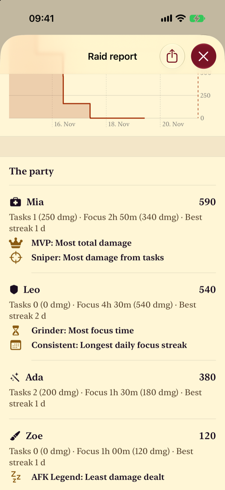
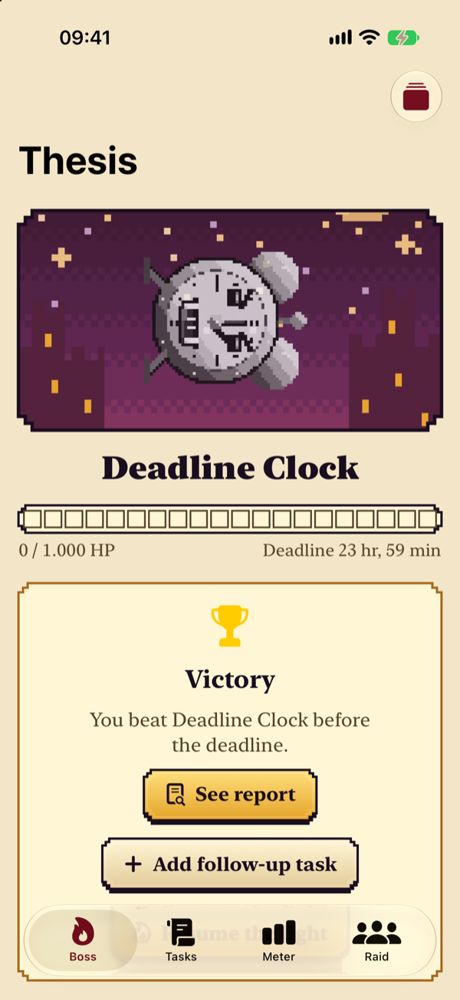
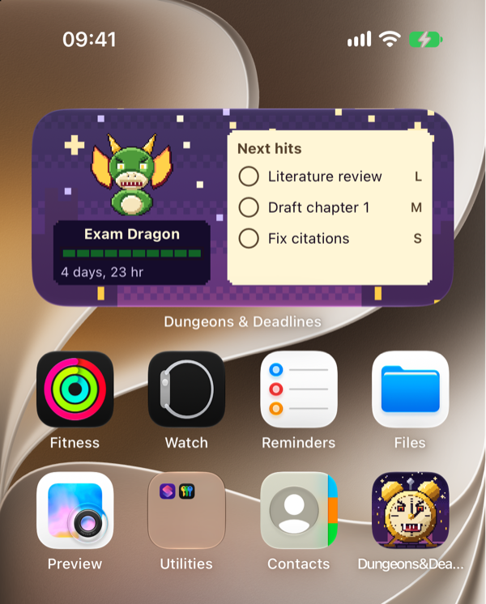
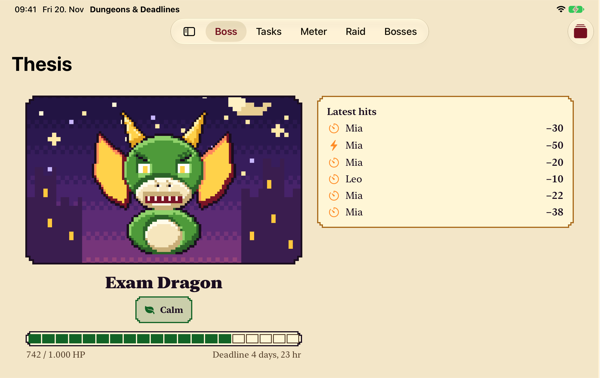

# Dungeons & Deadlines

A pixel-art RPG for iPhone and iPad where every deadline is a boss. You plan the tasks for a
project, start the fight, and then finishing tasks and running focus sessions deal damage. Beat
the boss before the deadline, alone or in a raid of up to 5 friends.

SwiftUI · iOS 26+ · SwiftData · App Intents · WidgetKit · ActivityKit · GameKit · StoreKit 2

<table>
  <tr>
    <td align="center"><br><sub>Boss</sub></td>
    <td align="center"><br><sub>Quest Log</sub></td>
    <td align="center"><br><sub>Damage meter</sub></td>
  </tr>
  <tr>
    <td align="center"><br><sub>Party</sub></td>
    <td align="center"><br><sub>Raid report</sub></td>
    <td align="center"><br><sub>Titles</sub></td>
  </tr>
  <tr>
    <td align="center"><br><sub>Victory</sub></td>
    <td align="center"><br><sub>Home Screen widget</sub></td>
    <td></td>
  </tr>
</table>

<p align="center"><br><sub>iPad: two-column Boss tab; the Bosses section lists every boss</sub></p>

## Features

**The fight**
- **Boss tab:** a pixel-art boss, its phase, an HP bar, the time to the deadline and the latest hits.
  Completing a task jumps here and plays your class's attack (mage orb, rogue daggers, tank shield
  slam, healer beam, or a plain sword).
- **Quest Log (Tasks tab):** tasks sized S / M / L (50 / 150 / 400 damage). Tap the checkbox or
  swipe to complete, swipe to delete, drag to reorder.
- **Focus timer:** 2 damage per focused minute (up to 3 hours a day), with a mini player in the tab
  bar, a Live Activity on the Lock Screen and in the Dynamic Island, and a Control Center / Lock
  Screen / Action button control.
- **Fair HP:** a raid starts with a planning phase. When the fight starts, max HP is locked from the
  planned tasks (about 65% from tasks, 35% from focus). Tasks added later still hit but are
  marked as late in the report. Focus streaks give ×1.1 / ×1.2.
- **Phases:** Calm, Angry (50% of the time left), Enraged (25%), Berserk (10%). The boss's eyes
  and the haptics follow the phase.
- **12 bosses** (clock, dragon, slime, lich, golem, kraken, goblin, mimic, ghost, spider,
  mushroom, cyclops). The look comes from keywords in the boss's name.
- **After the deadline:** add follow-up tasks and resume the fight, or delete old bosses.

**The party**
- **Raids of up to 5:** share a 6-character invite code; classes (Mage, Tank, Rogue, Healer) for
  flavor and attack animations; a per-member daily cap so nobody carries the team alone.
- **Damage meter (Meter tab):** burst (tasks) vs. sustained (focus) damage per member, as a chart
  or a list, plus who is attacking right now.
- **Raid report:** victory or defeat, HP over time, per-member stats, titles (MVP, Sniper,
  Grinder, Consistent, Last-Minute Hero, AFK Legend), late and undone tasks, and a share image.
- **Multiplayer needs a Firebase project.** Sync runs over Firebase REST (no SDK), polling every
  5 s while the app is open. No project is connected yet, so the build in this repo is solo-only
  until someone adds `GoogleService-Info.plist` (see [Setup](#optional-multiplayer-firebase)).

**Around the app**
- **Widgets:** Home Screen (small, medium, large) with tappable tasks, and Lock Screen
  (circular, rectangular, inline). Tinted and clear modes keep the boss readable.
- **Siri and Shortcuts:** "Start focus in Dungeons & Deadlines", "Complete a task in …", "Stop
  focus in …". Every action is an App Intent, so buttons, widgets, the Live Activity, the control
  and Siri share one code path.
- **Game Center:** 13 achievements and 3 leaderboards (total damage, bosses defeated, focus
  minutes).
- **iPad:** a two-column Boss tab and a sidebar for the tabs; bosses switch with the boss button at the top right.
- **Accessibility:** VoiceOver announcements for hits, audio graphs on the charts, phases never
  shown by color alone, Dynamic Type layouts up to AX5, and Reduce Motion support. Every UI flow
  runs Xcode's accessibility audit.

### Free and Premium

A soft paywall (StoreKit 2, `SubscriptionStoreView`). It can always be dismissed, and nobody loses
existing bosses or history. Details: [docs/MONETIZATION.md](docs/MONETIZATION.md).

| | Free | Premium |
|---|---|---|
| Solo bosses | 1 unfinished at a time | Unlimited |
| Create a group raid | — | ✓ |
| Join a friend's raid by code | ✓ | ✓ |
| Focus, widgets, Live Activity, report, Game Center | ✓ | ✓ |

Products: `at.fhooe.sail.dungeonsanddeadlines.premium.monthly` and `at.fhooe.sail.dungeonsanddeadlines.premium.yearly` (subscription group "Premium").

## Setup

Requirements:
- **Xcode 27.2** (the project builds with the iOS 27.2 SDK and simulator)
- **iOS 26.1** deployment target (Liquid Glass and the tab bar accessory API set the minimum; runs on iPhone 11 and newer)
- Nothing else for solo play. Python 3 is only needed for the art tools in `tools/`.

1. Clone the repo and open `DungeonsAndDeadlines.xcodeproj`. The only package is the local
   `Packages/DDKit`, so there is nothing to resolve from the network.
2. **Command-line builds:** if `xcode-select -p` points at the Command Line Tools, point the
   tools at Xcode (`build.sh` already does this for its own `xcodebuild` call):

   ```bash
   export DEVELOPER_DIR=/Applications/Xcode.app/Contents/Developer
   ```

3. **Signing:** the targets use automatic signing with the FH OO Studienbetriebs GmbH team
   (`UBQ8UHSHKQ`) and `at.fhooe.sail.*` bundle IDs. The simulator needs no changes. For a device
   build with another team, change the team and the bundle IDs of the app, the widget extension
   (`….widgets`) and the App Group (`group.at.fhooe.sail.dungeonsanddeadlines`) in
   **Signing & Capabilities**.
4. **StoreKit:** `Config/Products.storekit` holds both subscriptions, and the shared scheme uses it
   for Run and Test. If plans don't load when running from Xcode, select it under
   **Product → Scheme → Edit Scheme → Run → Options → StoreKit Configuration**. Purchases can
   then be managed in **Debug → StoreKit → Manage Transactions**. To skip StoreKit entirely, launch
   with `-premium`.

### Optional: multiplayer (Firebase)

Without Firebase the app runs solo; joining or creating group raids needs a backend. To connect
one:

1. Create a Firebase project, add an iOS app with the bundle ID
   `at.fhooe.sail.dungeonsanddeadlines`, and enable **Anonymous Authentication** and **Firestore**.
2. Download `GoogleService-Info.plist` into `DungeonsAndDeadlines/Resources/` (it's git-ignored).
3. Deploy the rules from `firebase/`: `firebase deploy --only firestore:rules`.

Or run against the local emulator with the `-useFirebaseEmulator` launch argument. Everything is in
[firebase/README.md](firebase/README.md).

## Run

Build for the simulator (uses the iPhone 18 Pro simulator; pick another with
`SIMULATOR="iPhone 17"`; derived data goes to `build/`):

```bash
./build.sh build
```

To run it, press **Run** in Xcode with the `DungeonsAndDeadlines` scheme, or install the
`build.sh` result on a booted simulator:

```bash
xcrun simctl install booted build/DerivedData/Build/Products/Debug-iphonesimulator/DungeonsAndDeadlines.app
```

```bash
xcrun simctl launch booted at.fhooe.sail.dungeonsanddeadlines -uiTesting -seedDemo
```

App and UI tests (the launch-time benchmark is slow, so skip it):

```bash
./build.sh test -skip-testing:DungeonsAndDeadlinesUITests/LaunchPerformanceTests
```

Package tests (game rules, persistence, intents, art, sync; run on macOS):

```bash
cd Packages/DDKit && swift test
```

### Debug launch arguments

Add these in **Edit Scheme → Run → Arguments**, or after the bundle ID in `simctl launch`.

| Argument | Effect |
|---|---|
| `-uiTesting` | In-memory store, fresh identity, no Firebase or Game Center |
| `-seedDemo` | A solo fight "Thesis" vs. "Exam Dragon" with 4 tasks, one done |
| `-startTab boss\|tasks\|meter\|raid` | Opens that tab |
| `-fakeTeammates` | 3 simulated teammates join and attack once a solo fight is running |
| `-seedFinished` | A won 4-player raid with a late task and an undone task (for the report) |
| `-meterAsList` | Damage meter opens as a list |
| `-premium` | Acts as a Premium subscriber |
| `-showPaywall` | Opens the paywall on launch |
| `-slowMotion` | Plays the task attack 5× slower |
| `-useFirebaseEmulator` | Uses the local Firebase emulator (works without `GoogleService-Info.plist`) |

Example: the screenshots above were taken with `-uiTesting -seedDemo -premium -fakeTeammates
-startTab meter` and similar.

## Project layout

```
DungeonsAndDeadlines/          the app: entry point, features (Boss, Tasks, Focus, Meter, Raid, Report), sync
DDWidgets/                     widgets, focus Live Activity, Control Center control
DungeonsAndDeadlinesUITests/   UI flows with accessibility audits, launch benchmark
Packages/DDKit/                local Swift package
  GameCore                     pure game rules: damage, HP, phases, streaks, titles, plan limits
  DDPersistence                SwiftData models and RaidStore (shared App Group store)
  DDIntents                    App Intents used by the app, widgets, controls and Siri
  DDDesign                     pixel-art bosses, theme, shared components
  DDSync                       Firebase Auth + Firestore over REST
Config/                        Info.plists, entitlements, Products.storekit
firebase/                      Firestore rules, rules tests, emulator config
tools/                         icon and pixel-art generators (svg2grid.py, make_icon.py)
docs/                          design docs, icon art, screenshots
```

## Docs

- [docs/HANDOFF.md](docs/HANDOFF.md): current status, commits, what's left, gotchas. Start here.
- [docs/ARCHITECTURE.md](docs/ARCHITECTURE.md): modules, data flow, sync, accessibility.
- [docs/MONETIZATION.md](docs/MONETIZATION.md): free vs. Premium rules, products, App Store Connect setup.
- [docs/GAME_CENTER.md](docs/GAME_CENTER.md): achievements, leaderboards, App Store Connect setup.
- [docs/IMPLEMENTATION_PLAN.md](docs/IMPLEMENTATION_PLAN.md): the original milestone plan (M0–M8).
- [firebase/README.md](firebase/README.md): Firebase project, emulator and rules tests.

## Decisions

The choices the docs refer back to:
- **Firebase over REST, without the iOS SDK.** The SDK added about 1.4 s to every launch.
- **Boss HP is locked when the fight starts** and current HP is derived from an append-only attack
  log, so every device shows the same number.
- **Local-first:** every action writes to the shared SwiftData store first; widgets, the Live
  Activity and the control read the same store.
- **iOS 26 minimum** for Liquid Glass. System chrome (tab bar, toolbars, sheets) stays Liquid
  Glass; in-content buttons use the pixel theme.
- **Art:** 64×64 pixel fantasy taken from the icon layers in `docs/icon/` (cream, gold and night
  purple).
